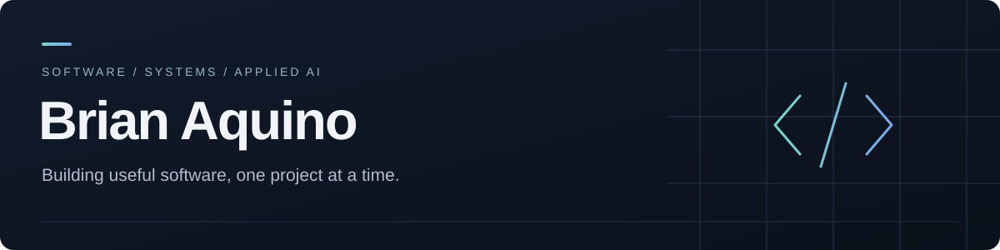
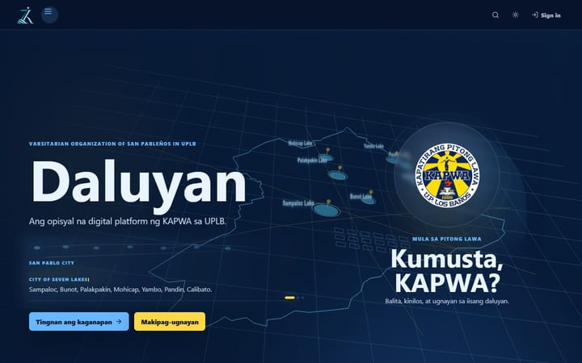
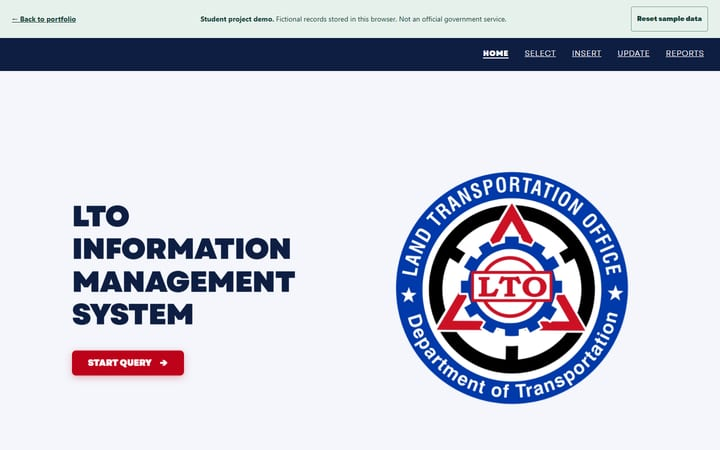
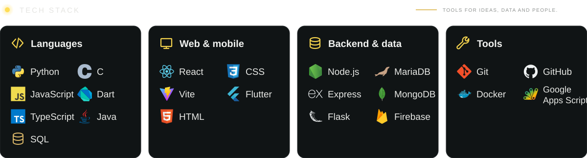
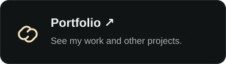

<picture>
  <source media="(max-width: 600px)" srcset="assets/profile-banner-mobile.svg">
  
</picture>

**UPLB Computer Science** · YSES Resident Member

I build practical websites and data-backed applications, and explore applied AI.

<!-- profile-stats:start -->
<picture>
  <source media="(max-width: 600px)" srcset="assets/profile-stats-mobile.svg">
  
</picture>
<!-- profile-stats:end -->

## Selected work

<table>
  <tr>
    <td width="42%"></td>
    <td><strong>Daluyan</strong> Community website  A digital home for KAPWA sa UPLB.  <a href="https://daluyan-kapwa-uplb.web.app/">Visit website →</a></td>
  </tr>
  <tr>
    <td width="42%"></td>
    <td><strong>LTO Project</strong> Student-built information system  Explore an interactive demo with fictional data.  <a href="https://bmaquino-lab.github.io/PORTFOLIO-WEBSITE/lto/">Try the demo →</a> &nbsp;·&nbsp; <a href="https://github.com/BMAquino-lab/LTOProject">Source code</a></td>
  </tr>
</table>

<picture>
  <source media="(max-width: 600px)" srcset="assets/tech-cards-mobile.svg">
  
</picture>

  
Skills as text

  
<strong>Languages:</strong> Python · JavaScript · TypeScript · C · Dart · Java · SQL

  
<strong>Web &amp; mobile:</strong> React · Vite · HTML · CSS · Flutter

  
<strong>Backend &amp; data:</strong> Node.js · Express · Flask · MariaDB · MongoDB · Firebase

  
<strong>Tools:</strong> Git · GitHub · Docker · Google Apps Script

<picture>
  <source media="(max-width: 600px)" srcset="assets/connect-heading-mobile.svg">
  
</picture>

  
  
  

<picture>
  <source media="(max-width: 600px)" srcset="assets/profile-footer-mobile.svg">
  
</picture>
